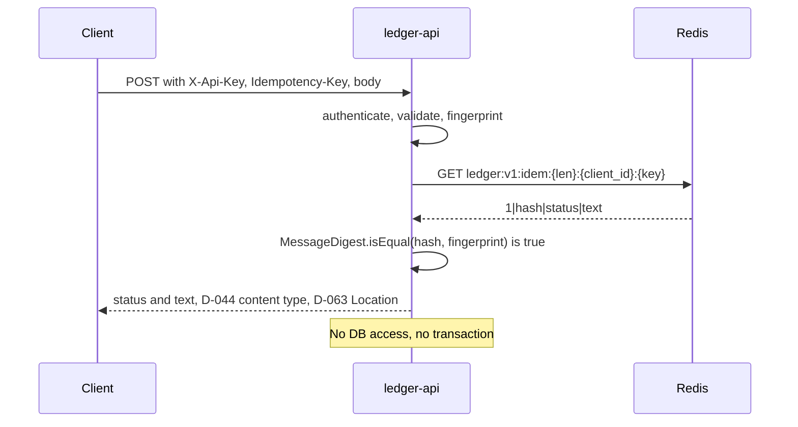
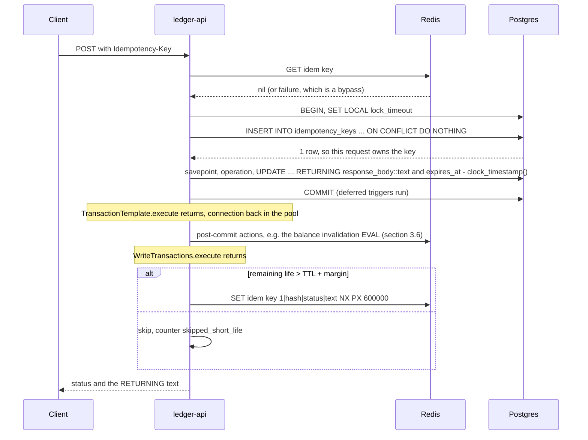
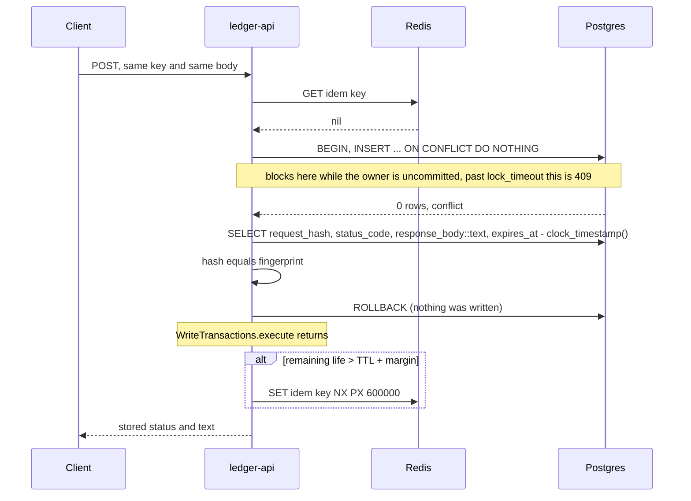
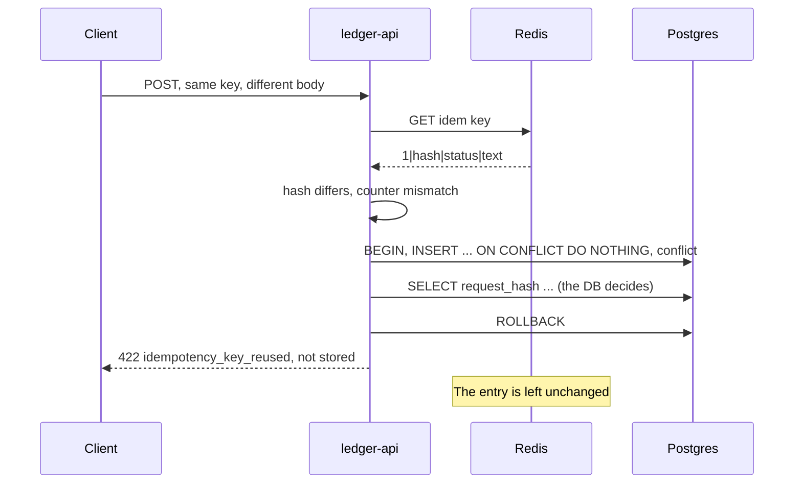
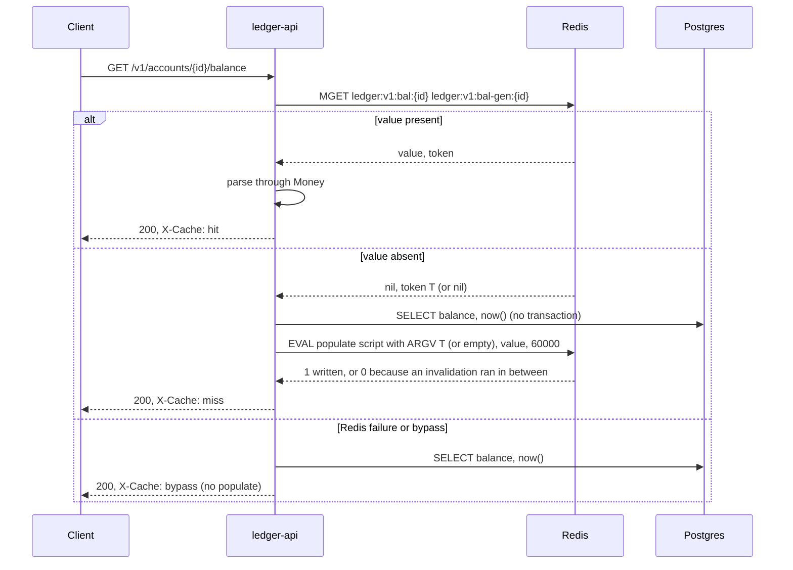
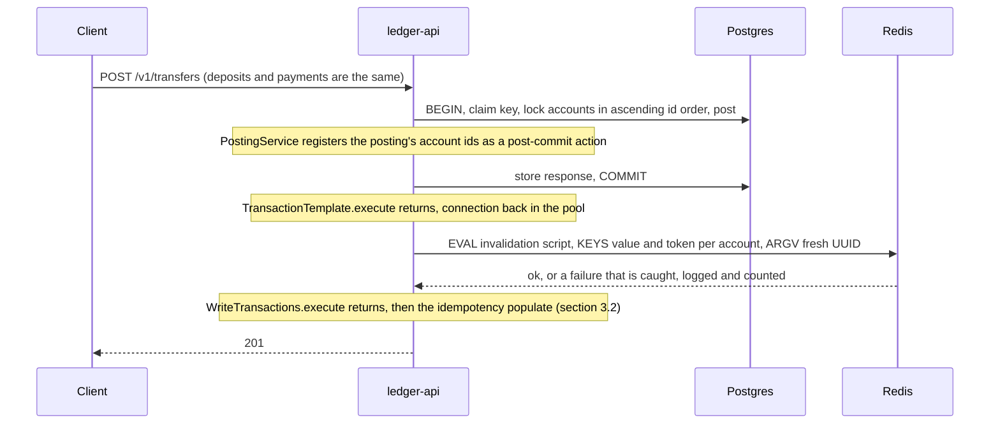
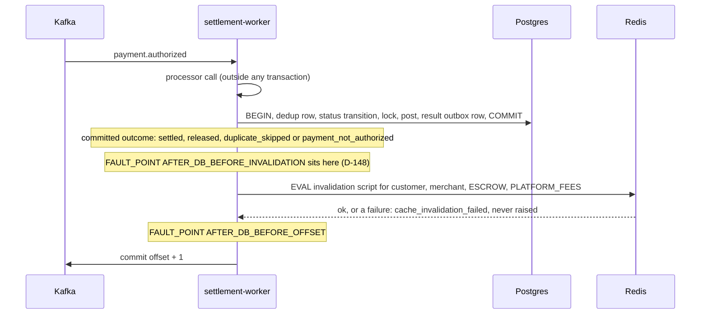
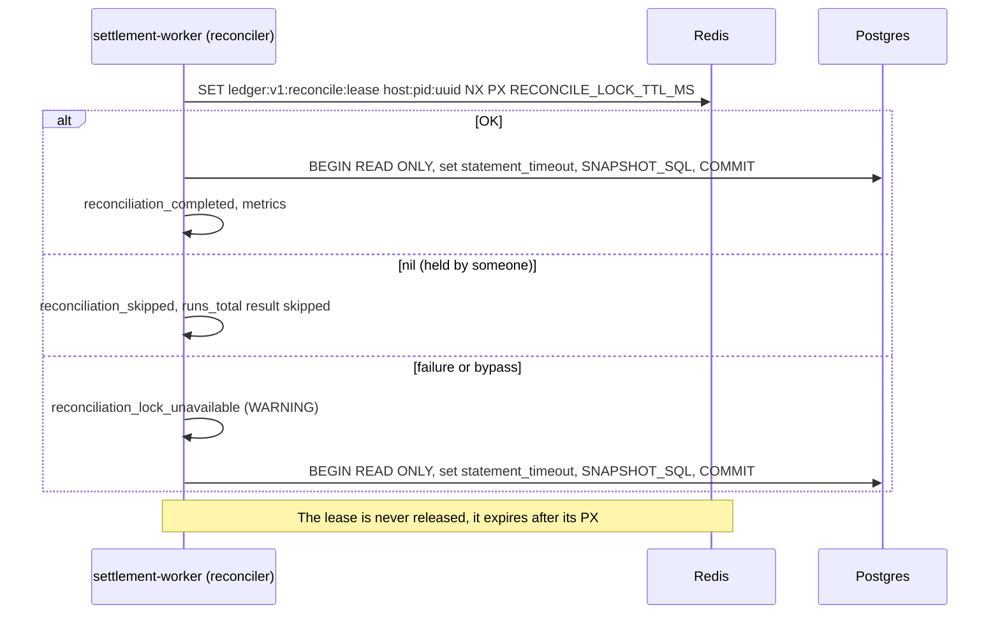

# Redis caches, invalidation and the reconciliation lease

> **Status:** M5 contract. Binds D-135 to D-148 (`docs/PROGRESS.md`); the Decision Log wins where they disagree.
> Every M5 task is reviewed against this document. A later task that departs from it changes this document **and**
> the affected Decision Log row text in the same PR.
>
> Claims tagged **(verify in T&lt;n&gt;)** are not yet verified; task T&lt;n&gt; verifies them and removes the tag, or
> corrects the claim. The appendix lists them. "T&lt;n&gt;" in a "proven by" cell names the task that will add the proof.

Redis has three jobs in this system: an idempotency fast path and a balance cache in ledger-api, and a reconciliation
lease in the settlement worker. Postgres stays the only authority for every outcome. Redis can make a request faster;
it can never make one different.

---

## 1. Authority (D-135)

### 1.1 Idempotency fast path

| Redis may decide | Redis may never decide |
|---|---|
| Replay a completed stored response (status and text) when the entry's stored fingerprint equals the request's | 422 `idempotency_key_reused`; 409 `idempotency_request_in_progress`; whether a key is new (owner or replay); anything for a key whose request is still in flight (never cached) or whose row was purged |

A fingerprint mismatch goes to the DB path, and only the DB answers 422 (§3.4). Unstored outcomes (D-045: 400, 401,
409 in progress, 422 key reused, 503, 5xx) never exist in `idempotency_keys`, so they can never reach Redis.

### 1.2 Balance cache

| Redis may decide | Redis may never decide |
|---|---|
| The body of `GET /v1/accounts/{id}/balance` | A funds check; any write path; any worker outcome; a 404 (not cached) |

Postings read balances only from rows they hold `FOR UPDATE` (`PostingService` in Java, the settle transaction's
ascending lock in Python). The cache is injected only into the balance endpoint, and the worker has no read path at all.

### 1.3 Reconciliation lease

| Redis may decide | Redis may never decide |
|---|---|
| Skip a reconciliation tick while another instance's lease is held | Whether reconciliation runs when Redis is unavailable (it runs); any drift result |

### 1.4 Every failure is a miss or a bypass

Refused, timed out, disconnected, flushed, evicted, unparseable or wrong-version: each is a miss or a bypass, bounded by
a timeout (§2.3), never retried, never a 5xx, and in the worker never a record failure. A Redis error never reaches the
D-107 classifier, so it can't cause a worker retry or a dead letter.

| Use | On failure |
|---|---|
| Idempotency fast path read | DB path (counter `result=bypass`) |
| Idempotency populate | Skipped; the next request reads the DB |
| Balance read | DB read, `X-Cache: bypass`, no populate |
| Balance populate (CAS) | Skipped |
| Invalidation (API or worker) | Logged without keys or bodies, counted (`cache_invalidation_failed` in the worker); the stale value lives at most the value TTL |
| Reconciliation lease | The tick runs (`reconciliation_lock_unavailable`, WARNING) |

After any failure, a 1 s in-process bypass skips reads, populates and the lease. It never skips an invalidation (§1.5).

### 1.5 Commands can execute late

**A client-side timeout doesn't mean the command didn't run.** A paused Redis container's kernel still accepts and
acknowledges TCP data; the bytes wait in the server's socket buffer and execute when it resumes. This is the D-099
broker lesson. Every command in this document must therefore be safe to execute late; §5 rows 2a–2e show that each is.

**A relative PX starts when Redis executes the command, not when it was sent.** Any delay before execution, in transit
or during a pause, comes out of whatever margin the PX was sized with. That is the idempotency margin's residual
(§5 rows 2a and 11). Closing Lettuce's connection after a timeout wouldn't help: the bytes are already in the paused
server's socket buffer and are read before the EOF.

**Same connection, same order.** ledger-api sends every Redis command on one shared Lettuce connection and never sends
`MULTI` on it (D-137), so its commands execute in the order they were sent, after a pause too. A posting's invalidation
and that client's next balance read share the connection: read-your-writes survives a pause as long as the
invalidation was sent. That is one more reason invalidations ignore the bypass: a bypassed invalidation is never sent.

**Across connections, no order.** The worker's invalidations arrive on its own connections, and Redis doesn't order
commands across connections. Both orders are safe for the compare-and-set (§4.2). An API `MGET` that executes before a
late worker invalidation serves the old value: the ordinary commit-to-invalidation window, stretched by the pause and
bounded by the value TTL (§5 row 2c).

### 1.6 Never inside a DB transaction (CLAUDE.md invariant 5, D-147)

Redis is a network call, and invariant 5 names it. Placement in ledger-api:

- The fast-path read runs before `WriteTransactions.execute` opens a transaction. The balance read path holds no
  transaction at all.
- Invalidations are post-commit actions: `WriteTransactions` runs them after `TransactionTemplate.execute` has returned
  (committed, connection back in the pool), never after a rollback, with no transaction synchronization active (D-147).
- The idempotency populate runs after `WriteTransactions.execute` has returned.

Spring runs `TransactionSynchronization.afterCommit` before it releases the connection **(verify in T6)**, which is why
D-147 rejects it: a Redis call there would hold a pooled connection for up to the command timeout on every posting.

In the worker: the invalidation runs after the settle transaction's `async with conn.transaction()` block has exited;
the lease `SET` runs before the snapshot transaction opens.

---

## 2. Keys, values and constants

### 2.1 Formats (D-139, D-142, D-144)

All keys start with `ledger:v1:`. A format change bumps `v1` in the key or the leading version field in the value,
never both silently.

| Key | Value | Notes |
|---|---|---|
| `ledger:v1:idem:{len}:{client_id}:{key}` | `1\|{hex(request_hash)}\|{status}\|{text}` | `len` = `client_id`'s UTF-8 byte length in decimal. `hex` = 64 lowercase hex digits. `status` = the stored `status_code` in decimal. `text` = `response_body::text` exactly as Postgres returned it, UTF-8. Parsed by splitting on the first three `\|` only; `text` may contain `\|`. |
| `ledger:v1:bal:{id}` | `1\|{balance}\|{as_of}` | `balance` = the `NUMERIC(19,4)` value as a plain scale-4 string (`100.0000`, `-250.5000` for EXTERNAL), read back through `Money` (sub-cent digits → 500, D-056). `as_of` = the filling read's `now()` in UTC with exactly six fractional digits and `Z` (the D-097 format). A hit's response body must be byte-identical to the miss response that filled it (T7). |
| `ledger:v1:bal-gen:{id}` | a canonical lowercase UUID (8-4-4-4-12) | The account's token. Replaced by every invalidation, `PX 300000`. |
| `ledger:v1:reconcile:lease` | `{host}:{pid}:{uuid}` | `SET NX PX RECONCILE_LOCK_TTL_MS`; never released. The value is for diagnosis only; nobody compares it. |

`{id}` is the account id in decimal. **Why the length prefix:** idempotency keys may contain `:` (0x21–0x7E, D-046),
and client ids come from config (D-049). Without the length, client `a:b` with key `c` and client `a` with key `b:c`
would both be `ledger:v1:idem:a:b:c`. With it they are `…:idem:3:a:b:c` and `…:idem:1:a:b:c`.

Example: client `acme`, key `order-42:retry` → `ledger:v1:idem:4:acme:order-42:retry`.

**Invalidation script.** The same text in Java and Python, pinned by literal-string tests in both languages (D-143).
`KEYS` holds one value-key/token-key pair per account touched by the posting, in that order. `ARGV[1]` is a fresh
UUID for this call. The `DEL` comes first so a value is gone even if a later write in the script fails.

```lua
-- ledger:v1 balance invalidation (D-142). KEYS: ledger:v1:bal:{id}, ledger:v1:bal-gen:{id} per account.
-- ARGV[1]: a fresh token for this call.
for i = 1, #KEYS, 2 do
  redis.call('DEL', KEYS[i])
  redis.call('SET', KEYS[i + 1], ARGV[1], 'PX', 300000)
end
return #KEYS
```

**Compare-and-set populate script** (ledger-api only). `ARGV[1]` is the token the `MGET` saw, or the empty string if
it saw none. An empty string can't equal a UUID, so "absent" is compared exactly.

```lua
-- ledger:v1 balance populate (D-142). KEYS[1]: ledger:v1:bal:{id}; KEYS[2]: ledger:v1:bal-gen:{id}.
-- ARGV[1]: token seen by the MGET ('' if absent); ARGV[2]: the value; ARGV[3]: the value TTL in ms.
local token = redis.call('GET', KEYS[2])
if token == false then token = '' end
if token ~= ARGV[1] then return 0 end
redis.call('SET', KEYS[1], ARGV[2], 'PX', ARGV[3])
return 1
```

### 2.2 Who reads and writes what

| Key | ledger-api | settlement-worker |
|---|---|---|
| `idem` | read (`GET`), write (`SET NX PX`) | — |
| `bal` | read (`MGET`), write (populate script), delete (invalidation script) | delete (invalidation script) |
| `bal-gen` | read (`MGET`, populate script), write (invalidation script) | write (invalidation script) |
| `reconcile:lease` | — | write (`SET NX PX`) |

**Connections.** ledger-api uses one shared `StatefulRedisConnection`: no pool and no `MULTI`, so its commands
execute in the order sent (D-137). On a shared connection, commands other threads send between `MULTI` and `EXEC`
join the transaction **(verify in T2)**, which is why invalidation is one `EVAL`, not a `MULTI`. The worker uses
redis-py's asyncio connection pool. Order across its own calls doesn't matter: each invalidation is one command, and so
is the lease.

### 2.3 Constants

| Constant | Value | Bound it must satisfy | Why |
|---|---|---|---|
| Fast-path TTL | 10 min | > 0 (validated at startup); TTL + margin < 24 h, the DB's `expires_at` default (D-043) | Bounds how long an entry lives once written. If TTL + margin ≥ 24 h, no row ever has enough remaining life to be cached: safe, but the fast path never hits (counter `skipped_short_life`). |
| Fast-path margin | 1 h | > 0 (validated at startup); > any delay between the DB measuring remaining life and Redis executing the `SET` (end of transaction, transit, a Redis pause) | An entry is written only if `expires_at − clock_timestamp()` > TTL + margin, so it expires at least one margin before its row can be purged (D-020, D-119). Durations only: clock skew between hosts doesn't matter (§5 row 10). A longer delay is the residual (§5 rows 2a, 11). |
| Balance value TTL | 60 s (benchmark mode B: 1 s) | > 0 | The worst-case staleness after anything the token can't cover: a failed invalidation, an evicted token, a JVM pause or a Redis pause longer than the token PX (§4.3). A product choice, measured in T15. |
| Token PX | 300 000 ms, a literal in the invalidation script | > a reader's `MGET`→CAS window = Hikari `connectionTimeout` (effective value; default 30 s) + `socketTimeout` (60 s, D-132) + 2 × command timeout ≈ 90.2 s | A token must outlive any reader that saw the token before it. Fixed in the contract so neither service needs the other's config. ledger-api refuses to start if the bound fails (T6), so raising a pool timeout can't silently break it. |
| Hikari `connectionTimeout` (input) | effective value read from the pool; not set in `application.yml` today, so 30 s | Input to the token bound | Bounds the wait for a pooled connection on a cache miss. |
| `socketTimeout` (input) | 60 s (D-132) | Input to the token bound | Bounds the miss's DB read. |
| Lease PX (`RECONCILE_LOCK_TTL_MS`) | default = `RECONCILE_INTERVAL_MS`; Compose 60 000 | ≥ 2 × `WORKER_DB_COMMAND_TIMEOUT_MS` + `RECONCILE_STATEMENT_TIMEOUT_MS` (50 000 with defaults) while the lease is active, else `config_invalid` naming both values, exit 2 | The longest run is connect (command timeout) + statement + client slack (command timeout, D-114). A live run ends, or is cut off, before its lease expires, so runs don't overlap while the DB timeouts work. |
| Command timeout | 100 ms | ≪ the API's request latency | Bounds what each Redis call can add while Redis is paused. |
| Connect timeout | 200 ms | — | Bounds a lazy connect attempt; a failed connect is a bypass. |
| Bypass | 1 s after any failure; skips reads, populates and the lease; **never invalidations** | — | A paused Redis then costs about one read timeout per second per process. Invalidations are always sent (§1.5). |

---

## 3. Ordering

### 3.1 Idempotency hit



### 3.2 Miss → owner → populate



### 3.3 Miss → DB replay → populate



### 3.4 Fingerprint mismatch → DB



### 3.5 Balance read



### 3.6 API posting (D-147)



A D-064 rollback to the savepoint still runs the action (the outer transaction committed): one extra miss, harmless.
A rollback of the whole transaction runs no actions.

### 3.7 Worker settle



The ids come from the event (customer, merchant) and from system ids memoized after the first lookup (D-048: they
never change), so the `duplicate_skipped` path, which reads no payment row, can still invalidate.

### 3.8 Reconciliation tick



---

## 4. The populate race

### 4.1 Without the token

Reader R serves `GET balance`; writer W posts on the same account. Balance 100.00 before W, 70.00 after.

| Step | R | W | `bal:{id}` |
|---|---|---|---|
| 1 | `GET` → miss | | absent |
| 2 | `SELECT balance` → 100.00 | | absent |
| 3 | | `COMMIT` (70.00) | absent |
| 4 | | `DEL bal:{id}` | absent |
| 5 | `SET bal:{id} 100.00 PX 60000` | | **100.00 (stale)** |

No further invalidation is coming, so every read for up to 60 s returns 100.00. With a long TTL this is the dangerous
case, and it is the D-051 mutation for T7's race case.

### 4.2 With the token

| Step | R | W | `bal:{id}` | `bal-gen:{id}` |
|---|---|---|---|---|
| 1 | `MGET` → value absent, token T1 | | absent | T1 |
| 2 | `SELECT balance` → 100.00 | | absent | T1 |
| 3 | | `COMMIT` (70.00) | absent | T1 |
| 4 | | invalidation: `DEL`, token → T2 | absent | T2 |
| 5 | populate script with T1 → token is T2 → returns 0, writes nothing | | absent | T2 |
| 6 | next read: `MGET` → absent, T2; `SELECT` → 70.00; populate with T2 → 1 | | 70.00 | T2 |

**Why every interleaving is safe.** R's `MGET` executes before its DB read starts. Any commit that R's read didn't see
committed after the read's snapshot, so its invalidation executes after R's `MGET`. If that invalidation executes
before R's compare-and-set, the token differs and the CAS writes nothing. If it executes after, it deletes what R
wrote. Either way a stale value can't outlive the writer's invalidation, which leaves only the commit-to-invalidation
window. This holds whatever the order across connections (§1.5), so a late API populate and a late worker
invalidation are safe in either order.

### 4.3 Residual cases

Each needs the token R compares against to have disappeared, so that "absent" matches "absent". Each is bounded by the
value TTL (60 s), because the stale value is written with `PX` = the value TTL.

| Residual | How it happens | Bound |
|---|---|---|
| Token evicted | R's `MGET` saw no token; W's new token is evicted (`allkeys-lru`) before R's CAS | Value TTL. A benchmark run with evictions is invalid (D-146). |
| Populate executes late | R's CAS is delayed in transit or by a pause. Safe while W's token is still there, which the token-PX bound guarantees for any delay the pool timeouts bound; past that it becomes one of the next two rows | Token PX, then value TTL |
| JVM pause | R's thread stops between `MGET` and CAS for longer than the token PX; W's token expires | Value TTL |
| Redis pause longer than the token PX | W's token was set before the pause and expires during it; R (which saw "absent") has a CAS queued, which executes on resume | Value TTL |

---

## 5. Failure modes

| # | Scenario | What callers see | Correctness impact | Bound | Proven by |
|---|---|---|---|---|---|
| 1 | Redis stopped (connection refused) | API: every call fails fast and goes to the DB path; `X-Cache: bypass`. Worker: `cache_invalidation_failed` on every settle; every reconciling instance runs each tick | None | Per call ≤ the 200 ms connect timeout until the client knows it's disconnected, then immediate (`REJECT_COMMANDS`) | T10 `RedisOutageTest` (stopped); T11 `test_redis_outage.py` (stopped) |
| 2 | Redis paused (the server accepts bytes but doesn't answer) | Each call waits the 100 ms command timeout; then 1 s of bypass for reads, populates and the lease; every posting's invalidation still waits up to 100 ms | None | 100 ms per call; about one read timeout per second per process | T10 (paused); T11 (paused) |
| 2a | Paused: an idempotency `SET NX PX` executes late on resume | The entry appears on resume with its 10 min PX starting then; its bytes are the DB's text | None while the delay before execution < margin. **Residual:** a longer delay lets the entry outlive its row's purge, so a purged key could replay | Margin (1 h) | T10 paused characterization: pause, an owner request completes (its `SET NX` times out), unpause → the entry exists, its bytes equal `response_body::text`, `PTTL` > TTL − 5 s (the TTL started at resume) |
| 2b | Paused: a populate `EVAL` executes late | Nothing visible: on the same connection, a later invalidation executes after it and deletes what it wrote; the token comparison still applies | None. Cross-connection order (a worker invalidation): both orders safe (§4.2) | Token PX, then §4.3 | T10 deterministic paused case: late populate `EVAL`, then the transfer's invalidation on the same connection → the next GET equals the DB (mutation: invalidation honours the bypass → stale hit). Cross-connection orders: argued (§4.2) |
| 2c | Paused: an invalidation `EVAL` executes late | Values are deleted on resume. The API's own: same connection, so read-your-writes holds. A worker's: an API `MGET` that executes before it serves the old value | Stale reads only: the commit-to-invalidation window stretched by the pause | Value TTL | T11 paused, plus a post-unpause check that every account touched during the pause reads equal to the DB once settled |
| 2d | Paused: a lease `SET` executes late | The instance already treated the lease as unavailable and ran; on resume a lease appears that nobody is running under, so other instances skip | None: up to one extra skipped period | One lease period | Argued |
| 2e | Redis paused longer than the token PX | A token set before the pause expires during it; a queued CAS from a reader that saw "absent" writes a pre-commit value | Stale reads only | Value TTL | Argued (§4.3) |
| 3 | `FLUSHALL` mid-run | Misses: idempotency replays come from the DB (byte-identical) and repopulate; balances are read from the DB. A reader that saw token T and CASes after the flush fails (T ≠ absent). The lease is gone, so another instance may run early | None for idempotency. A reader that saw "absent" before the flush and CASes after a writer's token was flushed can write a stale value (the §4.3 shape). A double reconciliation run is harmless (D-115) | Value TTL | T10 (flushed mid-run) |
| 4a | Eviction of a balance value | A miss; read from the DB | None | — | Argued |
| 4b | Eviction of a token | Nothing directly; reopens the populate race for one read (§4.3) | Stale reads only | Value TTL | Argued (§4.3); T14/T15 run validity (`evicted_keys` unchanged) |
| 4c | Eviction of an idempotency entry | A miss; DB replay | None | — | Argued |
| 4d | Eviction of the lease | Another instance may start a run before the period ends | None: a harmless double run (D-115) | One run | Argued; T13 case 4 shows double runs report no drift |
| 5 | A failed invalidation (Redis reachable, the command fails or times out) | The posting's response is unchanged; the API logs and counts; the worker emits `cache_invalidation_failed` | Stale reads only | Value TTL | Argued, plus the counter; T11 (stopped) exercises the Redis-down case |
| 6 | ledger-api started with Redis down | Startup succeeds (the connection is made lazily, D-137); the first calls bypass | None | — | T10 (context startup with Redis down). `RedisClient.connect()` throws when the server is down **(verify in T2)**, which is why the connection is lazy |
| 7 | Worker without `REDIS_URL` while the API caches | Settles and releases never invalidate: merchant, ESCROW, PLATFORM_FEES and (on a release) customer balances are stale after every settle | Stale reads only | Value TTL per read, but it recurs after every settle | Consequence shown by T9's red evidence ("worker doesn't invalidate → red"); detected by `worker_started.balance_invalidation` and the D-146 harness guard; Compose makes `REDIS_URL` required (open issue) |
| 8 | Postgres reset or restore without a Redis flush | Idempotency replays for rows that no longer exist; balances of another database state | **Wrong outcomes:** a request whose key replays from Redis is not executed. The same harm as rows 2a and 11, with no timing margin to protect against it, which is why the flush is a runbook step | Idempotency: fast-path TTL (10 min). Balances: value TTL | Runbook §9.1; residual |
| 9 | A test Redis shared across databases | One database's replays and balances served to another (account ids and test keys repeat) | Wrong test results | — | Prevented by D-138; T2: every test Redis asserts `DBSIZE = 0` before its first test |
| 10 | Clock skew between API, DB and Redis | Nothing | None: no absolute time is compared across hosts. Remaining life is measured by the DB; every PX is counted by Redis from execution. Only a jump in Redis's own clock changes when a PX ends | For idempotency, a Redis clock jump is a delay like any other: bounded by the margin | Argued |
| 11 | An idempotency `SET` delayed in transit for more than 1 h | As row 2a | Residual: a purged key could replay | Margin (1 h) | Argued; residual |
| 12 | `noeviction` under memory pressure (the rejected config) | Writes are refused with OOM errors, invalidations included | Stale reads, plus invalidations that fail outright | — | T2 records what the invalidation script does under `noeviction` **(verify in T2)**. Rejected by D-138 |
| 13 | A single blip trips the bypass while Redis is healthy | 1 s of DB reads and skipped populates; invalidations are still sent | None: latency only | 1 s | Argued |
| 14 | Worker crash between the settle commit and its invalidation | Redelivery → `duplicate_skipped` → invalidation | Stale reads until the redelivered record is processed | Redelivery time, and value TTL | T9 `test_balance_invalidation.py` (D-148) |
| 15 | ledger-api crash between commit and its post-commit invalidation | No redelivery exists. A client retry with the same key replays without posting, so it doesn't invalidate either | Stale reads only | Value TTL | Argued; residual |

---

## 6. Rejected alternatives

The "Rejected alternative" column of each row, verbatim.

- **D-135:** Redis as a second source of truth; fail-closed; treating a timed-out command as not executed
- **D-136:** spring-boot-starter-data-redis; Jedis; Redisson/Redlock (multi-master, an anti-goal); the Testcontainers redis module or extra
- **D-137:** Library defaults; eager connect at startup; a circuit-breaker library; bypassing invalidations; a connection pool (loses send order); MULTI on the shared connection
- **D-138:** Default RDB persistence; noeviction (a full Redis fails writes, invalidations included; behaviour observed in T2); one Redis shared across test contexts
- **D-139:** Deciding 422 in Redis; a TTL equal to expires_at; the purger DELing Redis keys; caching Jackson's bytes; an absolute PXAT deadline from the DB clock (swaps the pause bound for a clock-skew bound)
- **D-140:** Relying on no code updating completed rows; rejecting every update to a completed row (breaks the D-120 backdating fixture used by IdempotencyKeyExpiryTest, DbRolePrivilegesTest and M5's purge case)
- **D-141:** pg_terminate_backend timing; no rollback proof
- **D-142:** Delete-only cache-aside; API-only invalidation; invalidating inside or before the transaction; TransactionSynchronization.afterCommit (D-147); a token TTL of 2 × value TTL (couples two services' config); MULTI invalidation
- **D-143:** Convention only
- **D-144:** pg_try_advisory_xact_lock; session advisory lock; a lease table; fail-closed; releasing the lease after each run (allows N runs per interval)
- **D-145:** Only the spec §9 artifacts
- **D-146:** Shadow DB reads (over-count racing commits); comparing timestamps across clocks; Number arithmetic in the judge; Compose services for the API and worker in M5 (open issue)
- **D-147:** TransactionSynchronization.afterCommit / afterCompletion; invalidating in each controller
- **D-148:** Arguing it only; a fault point inside the invalidation call

Also rejected in this document, with no row of its own: **closing Lettuce's connection after a command timeout** to
stop a late execution. The bytes are already in the paused server's socket buffer and are read before the EOF (§1.5).

---

## 7. Lease and fencing (D-144)

### 7.1 Why the lease has no fencing token

A fencing token is checked by the resource being written: a stale holder's write carries an older token and is refused.
The reconciler writes nothing. Its run is one READ ONLY snapshot (D-114), and M4 proved each run correct on its own
(`test_reconciliation_snapshot.py`, D-118). Two overlapping runs cost one extra scan and produce two correct reports,
so there is nothing to fence.

### 7.2 What is needed if reconciliation ever writes

For example auto-repair, persisted results or a last-run row:

1. **A token from Postgres, not Redis.** `INCR` restarts at 1 after a flush or a restart (D-138: no persistence), and
   every new holder would then be fenced out by the highest token already recorded. The token has to come from a
   Postgres sequence, read when the lease is acquired.
2. **A fence row** holding the highest token that has written, owned by `ledger_api_owner` and created by a Flyway
   migration, with `SELECT` and `UPDATE` granted to `settlement_worker` (D-034 pattern) and covered by
   `DbRolePrivilegesTest`.
3. **A conditional write** in the same transaction as the effect: update the fence row only where its token is lower
   than the holder's, and abort if that affects 0 rows.
4. **The reconciler's transaction stops being READ ONLY**, which amends D-114 and needs its own proof that a run with a
   stale token writes nothing.

The lease stays in Redis to save scans; fencing would make it a correctness mechanism, which Redis can't be (D-135).

### 7.3 What "only one runs" means (amends spec §6.5)

- **Redis up:** at most one run starts per lease period across all instances. The lease is never released, so a dead
  holder and a live one look the same: the lease expires after its PX and the next tick on any instance takes it.
  Runs overlap only if one outlives the PX, which the startup bound prevents while the DB timeouts work.
- **Redis down or bypassed:** every reconciling instance runs every tick. That's harmless.
- **Scaling:** `docker compose up --scale settlement-worker=N` copies `RECONCILE_INTERVAL_MS` to every replica, so the
  lease is what makes scaling safe (amends D-115: the one-instance rule becomes a default).
- **Gauges:** an instance that skips keeps the drift gauges from its last run. M6's alerts must ignore instances whose
  last completed run is older than 2 × the lease (open issue).

---

## 8. Benchmark definitions (D-146)

### 8.1 Modes

| Mode | Balance cache | Redis |
|---|---|---|
| A | Invalidate on commit, value TTL 60 s | Up |
| B | TTL only, value TTL 1 s, invalidation off in both services (each logs a startup WARNING) | Up |
| C | As A | Stopped, then paused |

Same seed and the same k6 mix in every mode; 3 runs per mode.

### 8.2 Stack and mode guard

ledger-api (jar) and the worker run on the host against Compose's Postgres, Kafka and Redis. k6 runs as
`grafana/k6:2.3.0` (verified with `k6 version`) and reaches the API through `host.docker.internal`. The harness refuses
to start unless both services' startup lines report the mode's invalidation setting (`worker_started.balance_invalidation`
for the worker).

### 8.3 Stale judge

- Each VU owns disjoint customer accounts and one merchant, and is their only writer. It tracks their expected balances
  locally.
- A judged read is **stale** if the served balance ≠ the VU's expected balance.
- Merchant reads are judged only after the VU has seen its payment `SETTLED` (through `GET /v1/payments/{id}`, a DB
  read). Customer reads after a decline are judged only after it has seen `FAILED`.
- Expected balances are BigInt minor units parsed from the JSON strings, e.g. `"100.00"` → `10000n`. No `parseFloat`,
  `Number` or float arithmetic anywhere in the judge (D-011). k6 2.3.0 supports BigInt **(verify in T14)**.
- Foreign reads, on random accounts, drive populate races and aren't judged. A stale value they plant is caught by the
  owner's next judged read.
- Each stale read is classified by its `X-Cache` value. A stale hit is a cached value that's out of date. A stale miss
  is a DB read that's wrong, which is a defect (D-016). Stale bypass reads are DB reads too; they're reported separately
  and any non-zero count is investigated like a stale miss.

### 8.4 Hit rate

Hit rate = hits / (hits + misses + bypasses), over balance GETs that returned 200. Reported overall and judged-only.
Hit rate depends on the read:write mix, so it is always reported with it.

### 8.5 Run validity

A run counts only if every judged read completed, and Redis `INFO` `evicted_keys` is unchanged across the run (an
evicted token reopens the populate race, so a run with evictions isn't measuring the design).

### 8.6 Assertions

- Stale misses = 0 in every mode.
- Mode B stale reads > 0. This is the positive control: it shows the judge can see staleness.

### 8.7 The report

`docs/load-tests/m5-cache-benchmark.md`, per mode and run:

- hit rate, overall and judged-only;
- stale hits split by account role (customer, merchant); in mode A, the merchant ones are attributed to
  commit-to-invalidation windows;
- stale misses and stale bypass reads;
- read:write ratio, accounts per VU, VUs, duration, request rate;
- `k6 version`, hardware per D-024 (CPU model, logical CPUs, RAM, OS, Docker Desktop resources), commit SHA;
- latencies, labelled as test-load data, not M8's figures.

Numbers go only into Measured numbers (D-015): the existing row "Balance cache: hit rate / stale reads served,
invalidate-on-commit vs TTL-only", and the new row "Redis down: added latency (mode C stopped / paused vs A)".

---

## 9. Runbook

### 9.1 Flush Redis on any Postgres reset or restore

A restore (point-in-time recovery, `pg_restore`, a volume swap) or a reset makes every Redis entry describe a
database that no longer exists (§5 row 8). Order:

1. Stop ledger-api and the worker.
2. Reset or restore Postgres.
3. Flush Redis and confirm it's empty.
4. Start ledger-api and the worker.

```powershell
docker compose exec redis redis-cli FLUSHALL
docker compose exec redis redis-cli DBSIZE    # expect 0
```

`docker compose down -v` already wipes Postgres and Kafka together (D-028). Once T2 runs Redis without persistence
(D-138), a Redis restart empties it too; until then Compose's Redis keeps its RDB snapshot on an anonymous volume, so
flush explicitly.

### 9.2 Drills (PowerShell, repo root)

```powershell
# Pause: the server accepts bytes but doesn't answer (rows 2-2e). Watch X-Cache: bypass,
# cache_invalidation_failed and reconciliation_lock_unavailable, then resume.
docker compose pause redis
docker compose unpause redis

# Flush mid-run (row 3)
docker compose exec redis redis-cli FLUSHALL

# Inspect
docker compose exec redis redis-cli DBSIZE
docker compose exec redis redis-cli INFO stats | Select-String "evicted_keys"
docker compose exec redis redis-cli PTTL ledger:v1:reconcile:lease
docker compose exec redis redis-cli --scan --pattern "ledger:v1:bal:*" | Select-Object -First 20
```

---

## Appendix: claims to verify

| # | Claim | Where | Task |
|---|---|---|---|
| 1 | Spring runs `TransactionSynchronization.afterCommit` before it releases the connection (quote `AbstractPlatformTransactionManager` from the Spring Framework 7 source jar) | §1.6 | T6 |
| 2 | Lettuce `RedisClient.connect()` throws when Redis is down | §5 row 6 | T2 |
| 3 | Lettuce: commands from other threads join a `MULTI` on a shared connection (quote the reference guide's passage on transactions and shared connections) | §2.2 | T2 |
| 4 | What the invalidation script does when Redis is over `maxmemory` with `noeviction` | §5 row 12 | T2 |
| 5 | redis-py 8.1.0's default retry behaviour (D-137 sets retries to 0 explicitly either way) | D-137 | T2 |
| 6 | k6 2.3.0 supports BigInt | §8.3 | T14 |
